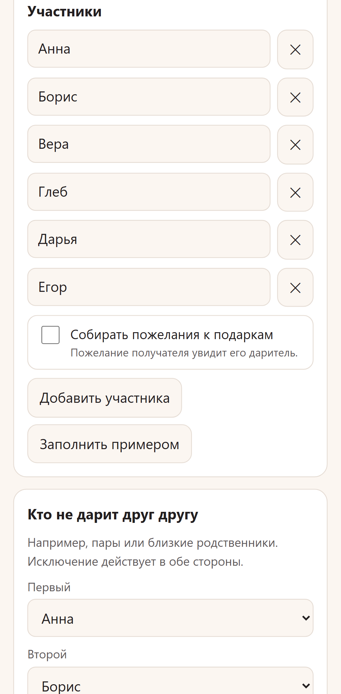
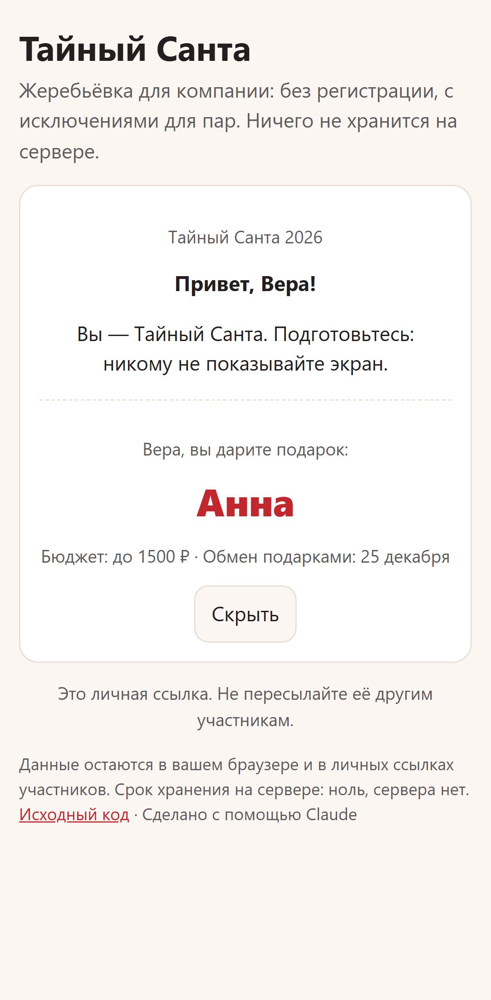

# Тайный Санта

[](https://github.com/Oleg4311/secret-santa/actions/workflows/ci.yml)

Жеребьёвка «Тайного Санты» для компании: без регистрации, с исключениями для пар, с личными ссылками или передачей телефона по кругу. Ничего не хранится на сервере: сервера нет.

**Открыть:** https://oleg4311.github.io/secret-santa/ · [English](#english)

<p>
  
  
</p>

## Быстрый старт

1. Откройте страницу и впишите участников (минимум трое). Кнопка «Заполнить примером» покажет, как это выглядит.
2. Добавьте пары, которые не должны дарить друг другу, при желании бюджет и дату.
3. Нажмите «Провести жеребьёвку» и разошлите личные ссылки (или передавайте телефон по кругу).

## Два способа раздать пары

| Способ | Как работает | Приватность |
|---|---|---|
| **Личные ссылки** | Каждому участнику уходит ссылка, в ней закодирована только его пара (кодирование не шифрование) | Организатор технически может открыть чужую ссылку, поэтому если вы играете сами, не делайте этого |
| **По кругу на одном устройстве** | Каждый нажимает своё имя, смотрит пару и нажимает «Скрыть» | Никто, включая организатора, не видит чужих пар: до нажатия цель вообще не попадает в страницу |

## Чем отличается

- **Ничего не уходит на сервер.** Жеребьёвка выполняется в вашем браузере, личные ссылки хранят данные во фрагменте URL (после `#`), который браузер не отправляет по сети. Регистрация и email не нужны.
- **Исключения с честным объяснением.** Если ограничения слишком жёсткие, приложение не зависает и не «перебирает до упора», а называет людей, которым не хватает получателей (условие Холла).
- **Корректная жеребьёвка.** Каждый дарит ровно одному и получает ровно от одного, не себе и не исключённым. Правильность проверяется сверкой с полным перебором на 1500 случайных наборах ограничений.
- **Приватность проверена тестами.** До нажатия «Узнать» цель подарка отсутствует в DOM, после «Скрыть» она удаляется. Имена и пожелания выводятся как текст, HTML в них не исполняется.
- **Мобильная версия на первом месте, тёмная тема, доступность (axe без серьёзных нарушений).**

## Как это работает

Жеребьёвка — это поиск совершенного паросочетания: каждому «кто кому может дарить» ставится в соответствие ровно один получатель.

1. Быстрые отказы: у кого-то нет ни одного возможного получателя или дарителя.
2. До 300 случайных перестановок с проверкой. Среди допустимых результатов выбор **равномерный** (проверено тестом на 9 000 запусков).
3. Если ограничения жёсткие и перестановки не попали, запускается поиск чередующимися цепями (алгоритм Куна) в случайном порядке: он находит ответ, если тот существует, но распределение в этом случае уже не строго равномерное.
4. Если ответа нет, объясняется почему.

Случайность берётся из `crypto.getRandomValues`.

## Ограничения

- **Ссылка не шифруется.** Тот, у кого она есть, видит пару. Отправляйте ссылку только самому участнику.
- **Жеребьёвку нельзя «восстановить».** Результат живёт только в открытой странице и в разосланных ссылках. Если закрыть страницу до рассылки, придётся провести заново (настройки игры сохраняются в браузере).
- Организатор не может быть «слепым» в режиме ссылок: для этого нужен сервер. Это запланировано отдельной версией (анонимные вопросы подопечному на Cloudflare Durable Objects). Режим «по кругу» уже даёт полную слепоту.

## Разработка

```
npm install
npm test            # алгоритм и формат ссылок (node:test)
npm run typecheck
npm run build       # сайт в site/
npm run e2e         # сценарии в браузере: десктоп и телефон (Playwright; один раз: npx playwright install chromium)
```

Тесты проверяют алгоритм (сверка с перебором, равномерность, объяснение отказа), формат ссылок и 13 сценариев в браузере, каждый на десктопе и на телефоне: настоящая жеребьёвка через открытие каждой ссылки, приватность, защита от внедрения HTML, перезагрузка, доступность в светлой и тёмной теме.

## English

**Secret Santa** in your browser: a draw with exclusions (couples who shouldn't gift each other), personal links or pass-the-phone mode. No sign-up, no server, nothing stored. The draw is uniform among valid assignments (rejection sampling) with a Kuhn matching fallback for tight constraints, and impossible setups are explained instead of hanging. Links keep the assignment in the URL fragment (never sent over the network) and are **not encrypted**; pass-the-phone mode keeps everyone's target out of the page until they tap their own name.

---

Лицензия MIT · Сделано с помощью Claude
